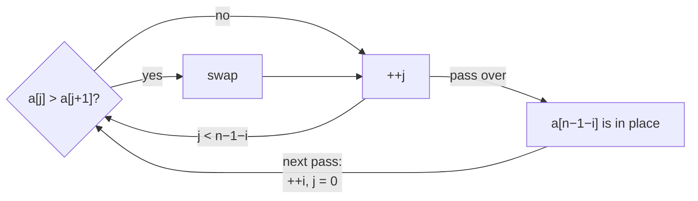

# Bubble sort

Bubble sort walks through the array again and again and swaps neighbours that
are out of order. After every pass the largest element of the unsorted part
"bubbles up" to the end, so the sorted tail grows by one element per pass.

## Try it

<div class="algo-viz" data-algo="bubble"></div>

## The idea



**Invariant:** after pass $k$ the last $k$ elements are the $k$ largest ones,
already in sorted order. That is why the inner loop can stop at `n - 1 - i`.

## Implementation

The code below is pulled from `code/sorting/bubble_sort.hpp`, which is compiled
and tested in CI on every push, so what you see here always builds.

=== "Simple"

    ```cpp
    --8<-- "sorting/bubble_sort.hpp:simple"
    ```

=== "Generic (C++20)"

    ```cpp
    --8<-- "sorting/bubble_sort.hpp:generic"
    ```

Usage:

```cpp
std::vector<int> v = {5, 1, 4, 2, 8};
bubble_sort(v);                                    // 1 2 4 5 8
bubble_sort(v.begin(), v.end(), std::greater{});   // 8 5 4 2 1
```

## Complexity

| Case                                        | Comparisons           | Swaps                 |
| ------------------------------------------- | --------------------- | --------------------- |
| Best: already sorted, with early exit       | $n - 1$               | $0$                   |
| Average                                     | $\Theta(n^2)$         | $\dfrac{n(n-1)}{4}$   |
| Worst: reverse order                        | $\dfrac{n(n-1)}{2}$   | $\dfrac{n(n-1)}{2}$   |

Without the early exit (the "Simple" version) every input costs exactly
$\frac{n(n-1)}{2}$ comparisons. Extra memory is $O(1)$, and the sort is stable.

!!! note "Swaps = inversions"

    An *inversion* is a pair of positions $i < j$ with $a_i > a_j$. Swapping two
    out-of-order neighbours removes exactly one inversion, so bubble sort makes
    as many swaps as the input has inversions: $0$ for a sorted array,
    $\frac{n(n-1)}{2}$ for a reversed one and $\frac{n(n-1)}{4}$ on average.

!!! tip "In real code"

    Use `std::sort`, or `std::stable_sort` if equal elements must keep their
    order. For small or nearly sorted ranges insertion sort is faster than
    bubble sort, which is why standard library implementations finish
    `std::sort` with it.

## Pitfalls

- **Unsigned underflow.** `for (std::size_t i = 0; i < n - 1; ++i)` breaks on an
  empty vector: `n - 1` wraps around to `SIZE_MAX`. Writing `i + 1 < n` avoids it.
- **`>=` instead of `>`.** Swapping equal elements still sorts, but the sort is
  no longer stable.

## See also

- [Sorting overview](index.md)
- [`std::sort` on cppreference](https://en.cppreference.com/w/cpp/algorithm/sort)
