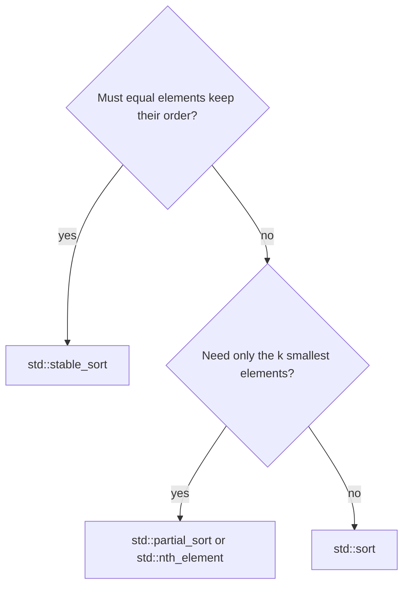

# Sorting

| Algorithm                     | Best             | Average          | Worst              | Extra memory  | Stable |
| ----------------------------- | ---------------- | ---------------- | ------------------ | ------------- | ------ |
| [Bubble sort](bubble-sort.md) | $O(n)$[^early]   | $O(n^2)$         | $O(n^2)$           | $O(1)$        | yes    |
| Selection sort                | $O(n^2)$         | $O(n^2)$         | $O(n^2)$           | $O(1)$        | no     |
| Insertion sort                | $O(n)$           | $O(n^2)$         | $O(n^2)$           | $O(1)$        | yes    |
| Merge sort                    | $O(n \log n)$    | $O(n \log n)$    | $O(n \log n)$      | $O(n)$        | yes    |
| Quicksort                     | $O(n \log n)$    | $O(n \log n)$    | $O(n^2)$           | $O(\log n)$   | no     |
| Heapsort                      | $O(n \log n)$    | $O(n \log n)$    | $O(n \log n)$      | $O(1)$        | no     |
| `std::sort`                   |                  | $O(n \log n)$    | $O(n \log n)$      |               | no     |
| `std::stable_sort`            |                  | $O(n \log n)$    | $O(n \log^2 n)$[^stable] |         | yes    |

[^early]: Only with the early exit: stop when a whole pass made no swaps.
[^stable]: $O(n \log n)$ when enough extra memory is available, $O(n \log^2 n)$ otherwise.

`std::sort` is usually an *introsort*: quicksort that switches to heapsort when
the recursion gets too deep, and insertion sort for small ranges. Since C++11
the standard guarantees $O(n \log n)$ comparisons in the worst case.

## Which one to use

## Same input, three quadratic sorts

All three widgets below sort the same array. Compare how many comparisons and
swaps each one needs.

### Bubble sort

### Selection sort

Finds the minimum of the unsorted part and swaps it to the front: at most
$n - 1$ swaps, but always $\frac{n(n-1)}{2}$ comparisons.

### Insertion sort

Takes the next element and moves it left until it is in place inside the sorted
prefix. On nearly sorted input it does almost no work.

