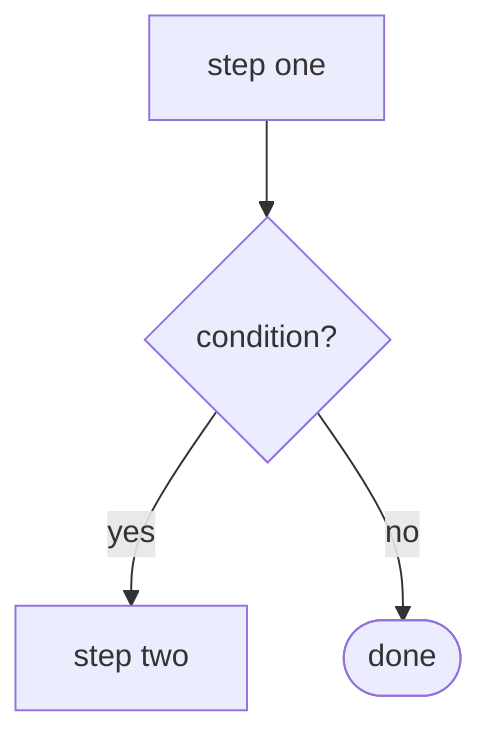

<!--
  Template for a new article. Copy it into docs/<section>/<name>.md.
  This folder is outside docs/, so the template itself is not published.
-->

# Algorithm name

One or two paragraphs: what problem it solves and the core idea in plain words.

## Try it

<!-- Remove this section if there is no visualization yet.
     Available algorithms are listed at the top of docs/javascripts/algo-viz.js. -->
<div class="algo-viz" data-algo="bubble"></div>

## The idea



**Invariant:** what stays true after every step. It explains why the algorithm works.

## Implementation

<!-- Put the code into code/<section>/<name>.hpp with
     // --8<-- [start:main] ... // --8<-- [end:main] markers,
     and its tests into code/<section>/<name>_test.cpp. -->

```cpp
--8<-- "section/name.hpp:main"
```

## Complexity

| Case    | Time          | Extra memory |
| ------- | ------------- | ------------ |
| Best    | $O(\cdot)$    | $O(\cdot)$   |
| Average | $O(\cdot)$    |              |
| Worst   | $O(\cdot)$    |              |

!!! note "Worth remembering"

    A fact that is easy to forget or often asked about.

## Pitfalls

- A typical bug and how to avoid it.

## See also

- [cppreference](https://en.cppreference.com/)
